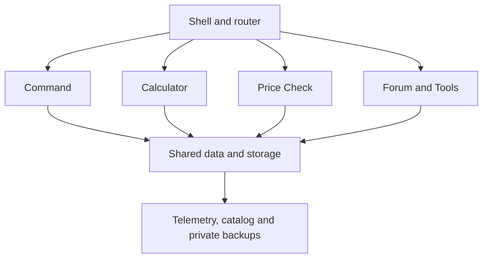

# RHW runtime and interface ownership

RHW is a dependency-free static application, not a framework rewrite.
The editable files are grouped by responsibility; generated bundles stay small in
request count. Edit an owner, not a new chronological fix/PR layer.

## Source ownership

| Location | Owns |
| --- | --- |
| `js/core/` | App shell, router, named lifecycle, primary/Tools navigation, refresh scheduling, boot and PWA |
| `js/command/` | Inventory, Shipyard, Production, Logistics and their navigation/status surfaces |
| `js/calculator/` | Catalog normalization, pure planning/costing, UI, labels, price profiles and Production bridge |
| `js/price-check/` | Fixed NPC sources, automatic pricing, provenance and refresh lifecycle; archived override compatibility |
| `js/forum/` | Composer, BBCode, preview formatting and mobile views |
| `js/data/` | Telemetry, storage, backup import/export and legacy archive compatibility |
| `js/tools/` | Discovery status, diagnostics, audit and private device transfer |
| `js/shared/` | Utilities, accessibility and shared workspace controls |

`scripts/runtime-assets.json` is the ordered source manifest. Classic lexical
scope is preserved in the dashboard bundle. Workspaces register before
`js/core/boot.js` starts the app.

## Public routes and compatibility

`scripts/app-routes.json` is the single public-route contract. The first node of
each workspace is its default. It generates `js/core/routes.js`, supplies the
browser smoke matrix and is validated against all PWA shortcuts.

Nine destinations are published: four Command areas, Calculator, Price Check,
Forum, Drafts and Senders. Overview is an internal status sensor, not a route.
Legacy Overview, Orders and Newswire URLs redirect to Inventory, Calculator and
Forum. Retired editors are absent from the runtime and repository; Git history
retains them. `js/data/legacy-archive.js` and the storage import/export contract
retain old backup data without recreating removed features.

## Named lifecycle, not method overrides

`app.lifecycle.on(phase, name, order, callback)` registers a synchronous hook;
the returned function unsubscribes it. Owners emit after completing their work.
Async owners await their work before emitting. Hook names are unique per phase,
numeric order is explicit, and thrown failures reach the boot failure surface.
`app.lifecycle.describe()` exposes the ordered registrations for inspection.

| Owner phase | Extension order |
| --- | --- |
| `shell:ready` | Workspace labels → primary navigation → Price Check |
| `command:ready` | Status navigation → shared controls → surfaces → Logistics views → Inventory toolbar → Shipyard selection |
| `command:before-activate` / `command:activated` | Scroll preparation, then status/control updates with previous and current node |
| `catalog:loaded` | Discovery semantics → recipe labels → Production batches → Shipyard requirements |
| `calculator:before-init` / `calculator:ready` | Session reset, then Production bridge → costing display → profiles → navigation → labels |
| `forum:ready` / `forum:activated` | Mobile views → workspace navigation |
| `discovery:ready` | Data-status tool placement |

Modules must not replace another module's `init`, `activate`, `installShell`,
`loadCatalog` or `buildPlan`. The validator rejects that pattern. Recipe planning
selects affiliation outputs without temporarily mutating shared catalog data.
Session-only material prices are enforced at the single storage write boundary;
named price profiles remain persistent.

`js/calculator/model.js` also owns explicit RHW quote imports. Quote provenance
shares the session-only price boundary; removed input preferences are discarded
from Calculator state. Imports value
Reactor Systems and Superstructure Systems at RHW's BASE SELLS quotation;
other inputs use BASE BUYS. Missing prices never fall back to the opposite
quotation direction. The captured source includes this direction and original
telemetry timestamp. Entered prices are preserved; refreshes require an
explicit import action.

The Shipyard's hull registry in `js/command/config.js` contains identities and
recipe IDs, not a separate set of component quantities. `shipyard-model.js`
uses the Calculator's direct material plan with RHW's BMM affiliation for each
selected ship. The Archon uses the civilian recipe, including its blueprint.
Reusable catalysts are displayed separately from consumed materials. Material
coverage is an alternative use of the shared inventory, never a reservation or
a sum of concurrently buildable ships. Unknown stock remains unknown; cached
stock is labelled. Selection is a local preference and is included in backups.

`js/command/config.js` selects the six installed Production modules by recipe
ID. `js/command/production-model.js` derives their consumed inputs, batch yields,
byproducts and non-consumed prerequisites from the same corrected BMM plan used
by the Calculator. The registry contains no duplicate recipe quantities. The
`catalog:loaded` hook at order 30 invalidates these batches after semantics
normalization (10), before the shared Command render (40). Missing recipes or an
unavailable catalog leave material coverage unknown.

Production derives each input's valid alternatives in catalog order and combines
their reported stocks automatically. Gold and Wildcat Gold therefore cover the
same input together, as do interchangeable fuels and Scrap Metal/Iron. Per-item
stock breakdowns remain visible; no manual input preferences are exposed or
applied. Invalid reported quantities leave capacity unknown. Calculator costing
and comparisons use their original default option; old selections are discarded.
The full inventory independently reads all reported positions; operational warning
boards continue to use their configured role scope.

## Trade Desk imports and exports

The header Trade Desk opens the same lazy dialog in either import or export
mode. Export Inventory and export-role manifest rows launch commodity-specific
buyer searches. Force Uplink is always visible in the connection panel, outside
its optional details. Additive recipe stocks use one full-name row per option;
their quantities and consumption order are unchanged.

`js/supply/export-planner.mjs` first fixes each export load using the exact
whole-unit accounting in `export-quote.mjs`. RHW BASE SELLS is the pilot purchase
cost; destination BASE BUYS is the payout. Stock reserves, ship volume, pilot
capital, buyer purchase room, cash and original-volume storage apply.
`return-planner.mjs` then considers profitable backhaul from the export buyer or
one pickup stop, selling to RHW or one other buyer in its home system. Extra
flight and docking time must fit the selected allowance; zero permits direct
backhaul at the existing stops. The outbound export quantity and delivery ETA
never decrease or get financed by a later return trade. Post-export cash,
storage and stocks are used, and the shared simulator verifies the entire tour.
Unspecified capital displays the actual start investment needed for both trades;
an entered budget is binding throughout the tour. The export commodity itself
cannot be re-imported as backhaul. A losing export cannot gain a recommendation
by hiding its loss behind return profit.

Search reserves time for backhaul, diversifies a bounded return shortlist and
reports pruning/time limits. Per buyer, prefer the best complete $/hour and
retain a comparison when paid backhaul would lower that rate. The UI separates
export revenue, export margin and return margin; empty returns have a reason.
The return-cargo checkbox restores the direct empty-return comparison.
`commodity-groups.mjs` filters the selector to the active mode and groups the
remaining goods by function: ship systems, production materials, metals/ores,
fuels/chemicals, base supplies, recycling/byproducts and other goods. Entries
sort alphabetically within each category. Configured import roles, material-market
sourcing targets and actual production inputs allow dual-role goods in both modes; a context commodity
cannot bypass the mode filter. Each mode remembers its own valid selection.
Wildcat Gold is an import and recipe input, not an export. Visible mode labels
are simply Import / Export; internal
`supply` identifiers remain compatible with existing route and worker contracts.
NPC markets, physical docking, BMM ID exclusions, unknown personal access,
snapshot provenance and cancellation retain the existing supply contracts.

On wide desktop headers, the wordmark occupies the left column and the crest
is centered absolutely inside a reserved middle column. Its height follows the
existing header bounds, so the primary navigation is not pushed down. Narrower
layouts keep the compact crest and accessible header actions.

`js/command/supply-routes.js` owns compact, labelled route icons beside commodity
names and the lazy dialog entry. Their SVGs are decorative; the buttons carry
the accessible commodity-specific action and hover hint. `css/supply.css` owns
their responsive touch targets and the charcoal/steel/gold supply dialog. The
bridge uses named lifecycle hooks and does not replace Production, Shipyard or Logistics
methods. The actual dialog lives in `js/supply/ui.mjs`. Its module worker runs
`planner.mjs`; the UI only receives numeric verified quotes and formats them.
The dialog suspends editable controls during a run and cancels work on close.

`js/supply/core/` is copied unchanged from PhyteHQ/DTR commit
`722e34d975f52eb6c1dd2f9d6d7bdb93a7dba0d4`: `trade.mjs`, `cargo.mjs`,
`navigation.mjs` and the LP solver with its bundled license. `ship-profiles.mjs`
and `assets/navigation.json.gz` share that source. No Corsair policy is imported:
`access.mjs` reads BMM ID rephacks and marks unresolved personal/POB access.

Supply quotes solve delivery quantity first, fix it, then optimize profit. The
shared transaction simulator verifies the resulting cargo, pilot cash, POB cash,
space, reserve and stock-limit changes. A zero-quantity optional trade becomes an
honest empty leg. Target goods cannot be exported on earlier legs. The verified
quote also separates the final material purchase cost, RHW payout, delivery
margin and loss from whole-run hauler profit.

The fastest direct quote whose target purchase does not exceed RHW payout sets
the normal time/throughput window. Supplier shortlisting reserves ordinary
sources separately from express POB offers. A nearer loss-making POB therefore
cannot shrink this window and hide the normal NPC circuit. Within the normal
window, `rankSupplyRoutes` recommends the best positive whole-run $/hour. A
profitable export cannot reclassify a loss-making material purchase as normal.
A faster express option can occupy one of the three result slots, with its loss
clearly displayed. Express-only results receive no recommendation metadata or
gold recommendation border. Candidate caps/time limits remain visible, and
optional side trades still have at most one extra stop.

The runtime manifest's `modules` entries are copied to dist and hashed into the
same release/offline shell as the bundles, including the compressed navigation
asset and solver license. They do not load into the main page before use.
Market snapshots are cached in a dedicated IndexedDB database; cache failure does
not prevent a live calculation. Every open/search checks POB age. NPC/ship data
have separate timestamps and retention. Failed refreshes keep saved timestamps
and label saved data, rather than inventing current quotations.

## Rendering and background work

`js/core/refresh.js` owns scoped `onRender(view, callback)` notifications and
`createRefreshTask`. Render hooks run after the owning renderer and must not
recursively call that renderer. `app.onUiUpdate` coalesces shared status changes.
Focused inputs and expanded seller cards survive refreshes.

A refresh task has one due time and one in-flight promise. Hidden/offline pages
do not schedule network work. Returning performs one overdue refresh, without
replaying missed intervals. Price Check refreshes only in its visible workspace.
PWA update checks run hourly while visible/online; activation still waits for
UPDATE NOW. Discovery workflow status is requested only through CHECK LATEST RUN.

## CSS ownership

The nine ordered stages preserve the established cascade and appearance:

| File | Responsibility |
| --- | --- |
| `css/tokens.css` | Shared literal palette |
| `css/foundation.css` | Local fonts, dashboard structure and base components |
| `css/workspaces.css` | Shell, navigation, Forum and Calculator foundations |
| `css/responsive.css` | Mobile/accessible controls and workspace adaptations |
| `css/tools.css` | PWA, Discovery, diagnostics, transfer and audit surfaces |
| `css/components.css` | Shared controls and component variants |
| `css/theme.css` | Current industrial theme and typography |
| `css/layout.css` | HUD, cards, grids and responsive geometry |
| `css/recipes.css` | Shared-price recipe comparison |

Keep changes in the owning stage. Do not append another release-wide override
file or inject CSS from JavaScript. Specificity and intentional `!important`
rules were retained to avoid visual regressions; consolidation is not a redesign.

## Build and deployment

Run `python3 scripts/build_app_assets.py` after edits. It generates bundles,
routes, metrics, the offline shell, HTML asset queries and build metadata. The
release revision is a SHA-256 digest of every deployed input, including icons,
fonts, catalog, bootstrap, manifest, HTML and worker logic. Rebuilding unchanged
sources is byte-identical. A content change also changes the service-worker file
itself; no manual version bump is required.

CI uses `--check` to reject stale output. `--check --dist` packages only 31
runtime/license files. Pages publishes `dist/`, never source modules, tests,
docs or local artifacts. Discovery proposals rebuild/stage the generated bundles
and revision before review; automation never merges its own catalog changes.

The Forum preview logo is local and cached. Exported BBCode uses the public
absolute PNG URL, so posts remain portable outside RHW. Installation icons use
standard 8-bit PNG channels; the optimizer verifies decoded target samples.
Crest and Forum artwork retain their original samples.

## Verification

- `python3 scripts/validate_dashboard.py`: shipped files, routes, manifest and build.
- `python3 scripts/test_build_assets.py`: revision sensitivity, idempotence and dist.
- `node scripts/test_app_contracts.js`: real router, defaults, storage policy and hooks.
- `node scripts/test_runtime_lifecycle.js`: background scheduling and render hooks.
- Other `test_*.js` / `test_discovery_sync.py`: catalog, quotes, provenance and backups.
- `python3 scripts/smoke_v40.py`: all nine public routes and workflows.
- `RHW_SMOKE_SITE=dist python3 scripts/smoke_interface_foundation.py`: actual deployed
  bundles at nine widths (360–1920 px), focus, local fonts and offline reload,
  including the Forum logo. Additional focused smoke tests cover Logistics,
  compact Command, primary navigation and recipe semantics.

Browser checks use controlled game-data fixtures, not a live-API availability
guarantee. Screenshots and detailed results are published as CI artifacts.
